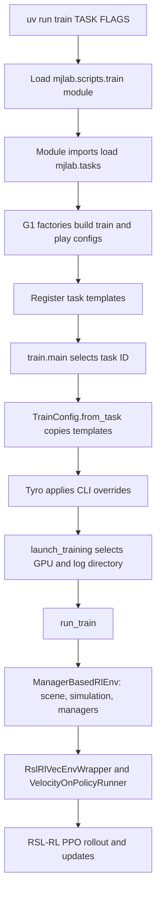

# Trace a G1 training run and plan a crawling task

Example: **`Mjlab-Velocity-Flat-Unitree-G1`**, using `ManagerBasedRlEnv`.
This page follows the actual source in this branch, including the RSL-RL training
dependency. The crawling section is a proposal; a crawl task is not registered
or trained by this change.

## 1. Procedure and run evidence

**Executed successfully on PACE-ICE on October 26, 2026.**

| Item | Recorded result |
| --- | --- |
| Source revision | `26b82920502aef59b06eec8803aa7b6cfd938384` on `codex/mjlab-upstream` |
| Slurm job | `6620137`, `COMPLETED`, exit `0:0` |
| GPU / node | NVIDIA H200, `atl1-1-03-017-23-0` |
| NVIDIA driver | `615.71.09` |
| Python / mjlab | Python 3.12.16; mjlab 1.6.0 from this source checkout, not the release-tag snapshot |
| Packages | PyTorch `2.14.0+cu130`, MuJoCo/MuJoCo-Warp `3.16.0`, Warp `1.18.0`, RSL-RL `5.5.1` |
| CUDA checks | Actual PyTorch and Warp allocations passed. Warp reported toolkit/driver CUDA 13.4; PyTorch uses its cu130 build. |
| Training | 32 environments, 2 PPO iterations, seed 7, TensorBoard |
| Actual dimensions | 29 actions; actor observations 99; critic observations 111 |
| Job wall time | 3 min 6 s, including imports, first-use compilation, and profiling overhead |
| Saved results | `model_0.pt`, `model_1.pt`, ONNX policy, TensorBoard events, and both resolved YAML configurations |

Run directory on PACE:

```text
~/scratch/mjlab/logs/rsl_rl/g1_velocity/
  2026-10-26_19-53-17_execution_trace_job6620137/
```

The final checkpoint is `model_1.pt` because iterations are zero-indexed. Its
saved environment step count is 48. The downloaded checkpoint loaded
successfully, and its tensor values were finite. The smoke run establishes
execution of simulation and learning, not a useful walking policy.

The evidence bundle includes stdout/stderr, the call trace, resolved configuration
inventory, saved YAML files, checkpoints, ONNX output, and tracing tools.

### Install and activate on the PACE login node

```bash
cd ~/scratch
git clone --branch codex/mjlab-upstream \
  https://github.com/wognl0402/unitree_rl_mjlab.git mjlab
cd mjlab
source env.sh
git rev-parse HEAD
```

For an existing clean checkout, use `git pull --ff-only`, then `source env.sh`.
The first real installation exposed a Conda alias conflict on PACE. Commit
`26b8292` fixes it by using `CONDA_ENVS_DIRS` and clearing the conflicting
`CONDA_ENVS_PATH` alias after loading the module. No global Conda configuration
or shell startup file is edited.

### Run directly on an allocated GPU

```bash
salloc --partition=ice-gpu \
  --constraint=cuda13 --gres=gpu:1 --nodes=1 --ntasks=1 \
  --cpus-per-task=4 --mem=32G --time=00:20:00
srun --pty bash -l
cd ~/scratch/mjlab
source env.sh --check
uv run train Mjlab-Velocity-Flat-Unitree-G1 \
  --env.scene.num-envs 32 \
  --agent.max-iterations 2 \
  --agent.logger tensorboard \
  --agent.seed 7 \
  --agent.run-name g1_flow_smoke
```

The check must pass real PyTorch and Warp GPU allocations. The training command
then creates 32 environments and runs two PPO iterations. This verifies the
pipeline; it is not enough training to produce useful walking.

The equivalent batch command, from the login node in the repository root, is:

```bash
mkdir -p logs/slurm
sbatch --time=00:20:00 scripts/pace/train_g1.sbatch 32 2 g1_flow_smoke
```

The batch script adds `_job<JOB_ID>` to the run name. For the recorded run, a
separate observation-only Python profiling hook records selected function calls
while the normal `uv run train` command executes. It does not change task
configuration, rewards, actions, or PPO. Its timing includes profiling overhead.

### What the runtime trace confirmed

| Selected call | Count in the successful process |
| --- | ---: |
| `unitree_g1_flat_env_cfg` | 2: training and play templates |
| `unitree_g1_rough_env_cfg` | 4: its own templates plus calls from the flat factory |
| `PPO.construct_algorithm` | 1 |
| `PPO.act` / `PPO.process_env_step` | 48 each |
| `ManagerBasedRlEnv.step` | 48 |
| `Simulation.step` | 192 |
| `PPO.compute_returns` / `PPO.update` | 2 each |

The trace records the G1 factories and registration **before** `train.main`, then
`TrainConfig.from_task`, config loading, launch, environment construction,
wrapping, runner construction, and PPO calls. This distinguishes configuration
instantiation from runtime environment creation using actual call order.

To reproduce the observation-only trace, copy the bundle's `tracing_tools/`
directory to `~/scratch/mjlab-trace-hooks` on PACE, then run inside a GPU
allocation from this checkout:

```bash
mkdir -p logs/trace
MJLAB_EXECUTION_TRACE="$PWD/logs/trace/g1_repeat" \
PYTHONPATH="$HOME/scratch/mjlab-trace-hooks${PYTHONPATH:+:$PYTHONPATH}" \
uv run train Mjlab-Velocity-Flat-Unitree-G1 \
  --env.scene.num-envs 32 --agent.max-iterations 2 \
  --agent.logger tensorboard --agent.seed 7 --agent.run-name trace_repeat
```

Each Python process writes a PID-suffixed JSON file at exit. Select the file whose
`argv` names `train` and whose counts contain `OnPolicyRunner.learn` and
`PPO.update`.
The hook stays silent on stdout, including in Python subprocesses used by GLFW.
The included `run_trace.sbatch` runs the same traced command as a batch job.

## 2. Command line to task configuration



### Entry point and import chain

1. [`pyproject.toml`](../../pyproject.toml) declares
   `train = "mjlab.scripts.train:main"`. `uv run train ...` invokes that console
   entry point using the environment selected by `env.sh`.
2. Loading `mjlab.scripts.train` evaluates its module-level
   `from mjlab.tasks.registry import ...`. Python first loads the parent
   `mjlab.tasks` package, so registration happens **before `train.main()`**.
   [`main()`](../../src/mjlab/scripts/train.py#L230) also explicitly imports
   `mjlab.tasks`, but by then the package is cached and registration is not
   repeated. Importing a configuration module and starting simulation are
   separate events.
3. [`tasks/__init__.py`](../../src/mjlab/tasks/__init__.py) calls
   `import_packages(__name__, ["utils", ".mdp"])`. The
   [recursive importer](../../src/mjlab/utils/lab_api/tasks/importer.py) imports
   task packages, including `mjlab.tasks.velocity.config.g1`.
4. [`g1/__init__.py`](../../src/mjlab/tasks/velocity/config/g1/__init__.py)
   imports the G1 environment and PPO factories. It **calls**
   `unitree_g1_flat_env_cfg()` and `unitree_g1_flat_env_cfg(play=True)` inside
   `register_mjlab_task(...)`. These are configuration objects, not simulated
   environments. Both train and play templates are built at import time.
5. The flat factory in
   [`g1/env_cfgs.py`](../../src/mjlab/tasks/velocity/config/g1/env_cfgs.py#L188)
   calls `unitree_g1_rough_env_cfg(play=play)`, which calls
   [`make_velocity_env_cfg()`](../../src/mjlab/tasks/velocity/velocity_env_cfg.py#L39).
   The order is **generic velocity task → G1 specialization → flat-terrain
   specialization**. Flat G1 construction briefly builds a rough configuration
   and then replaces its terrain settings; no rough terrain simulation is built.
6. [`registry.py`](../../src/mjlab/tasks/registry.py) stores those objects and
   `VelocityOnPolicyRunner`. `TrainConfig.from_task()` calls `load_env_cfg()` and
   `load_rl_cfg()`, which return **deep copies**.
7. Tyro parses the remaining flags against those copies. Consequently
   `--env.scene.num-envs 32` replaces the factory default of 1, and
   `--agent.max-iterations 2` replaces the PPO default of 30,000.

Changing a configuration file affects subsequent Python processes. It does not
reconfigure an already running job. Editing the registered template in one
process also does not retroactively change a copy already given to the trainer.

### Environment creation and PPO setup

[`launch_training()`](../../src/mjlab/scripts/train.py#L182) creates a timestamped
log path and selects GPUs relative to Slurm's `CUDA_VISIBLE_DEVICES`. With one
GPU it calls `run_train()` directly; multi-GPU execution uses `torchrunx`.

[`run_train()`](../../src/mjlab/scripts/train.py#L49) sets the device and seed,
then constructs `ManagerBasedRlEnv(cfg.env, device=...)`. This is where actual
simulation begins, after all CLI overrides have been applied. This velocity
task requires no motion dataset or W&B account when using TensorBoard.

The [environment constructor](../../src/mjlab/envs/manager_based_rl_env.py#L177):

1. Creates `Scene(cfg.scene)`. The scene attaches the G1 entity, a flat terrain
   entity, and sensors into a combined MuJoCo specification.
2. Creates `Simulation` from that specification. MuJoCo compiles the model;
   MuJoCo-Warp provides batched simulation state on the GPU.
3. Initializes scene entities and sensor context against the compiled model.
4. Loads managers in this order: **events → commands → actions → observations
   → terminations → rewards → curriculum → metrics → recorders**. Empty optional
   manager configurations get null managers. Startup randomization runs after
   manager creation.

`run_train()` wraps the environment in
[`RslRlVecEnvWrapper`](../../src/mjlab/rl/vecenv_wrapper.py). Its constructor
calls `env.reset()`; it converts observation dictionaries to TensorDicts,
combines termination and timeout flags, and forwards timeouts for value
bootstrapping.

The trainer writes `params/env.yaml` and `params/agent.yaml`, then creates the
registered `VelocityOnPolicyRunner`. Its inheritance chain is:

```text
VelocityOnPolicyRunner       mjlab/tasks/velocity/rl/runner.py
  → MjlabOnPolicyRunner      mjlab/rl/runner.py
    → OnPolicyRunner        installed rsl_rl/runners/on_policy_runner.py
      → PPO                 installed rsl_rl/algorithms/ppo.py
```

The runner creates the actor, critic, PPO optimizer, rollout storage, and logger.
`runner.learn(...)` performs rollouts and updates. PPO's source is in the
installed dependency, not in `src/mjlab`. Locate it in your active environment:

```bash
uv run python - <<'PY'
import inspect
from rsl_rl.runners import OnPolicyRunner
print(inspect.getfile(OnPolicyRunner))
PY
```

Saving a checkpoint includes
the policy, optimizer, iteration and mjlab environment step count. The velocity
runner also attempts ONNX export; an ONNX export warning alone does not mean PPO
training failed.

## 3. What one training iteration actually does

The G1 [PPO factory](../../src/mjlab/tasks/velocity/config/g1/rl_cfg.py) uses 24
control steps per rollout, 5 learning epochs, and 4 minibatches. With 32
environments, one iteration collects **768 transitions**. Two iterations collect
**1,536 transitions**.

RSL-RL's `OnPolicyRunner.learn()` repeatedly does:

```text
PPO.act(observations)
  → wrapper.step(actions)
    → ManagerBasedRlEnv.step(actions)
  → PPO.process_env_step(next_observations, rewards, dones, extras)
After 24 steps: PPO.compute_returns(...) → PPO.update()
```

Inside [`ManagerBasedRlEnv.step()`](../../src/mjlab/envs/manager_based_rl_env.py#L386):

1. Process raw actions once: scale, offset, and optional clipping.
2. Repeat four physics substeps: apply actuator targets, write scene state,
   advance simulation, update entity data, and accumulate substep metrics.
3. Increment episode counters; evaluate terminations and rewards.
4. Apply interval/step events. Reset only environments that ended; reset also
   applies reset events and resets manager state.
5. Run `sim.forward()` to refresh derived quantities. Update commands, with zero
   elapsed command time for newly reset environments, then sense and compute the
   next observations.
6. Return observations, reward, terminated flags, timeout flags, and extras.

The physics timestep is **0.005 s**, with **decimation 4**: policy control is
**0.02 s / 50 Hz**. A 20-second episode is at most 1,000 control steps. An episode,
a control step, a physics substep, and a PPO iteration are different units.
The runner starts with randomized episode counters (`init_at_random_ep_len=True`),
so a copy can time out during the first short rollout without actually simulating
20 seconds since program startup.

This revision deliberately evaluates rewards/terminations before the final
`forward()`; its derived state has a consistent one-physics-substep lag. New MDP
functions should follow this existing contract and avoid reading stale derived
state immediately after writing reset state.

## 4. Configuration map for this exact G1 task

### Robot, scene, actions, commands, and resets

| Configuration | Effect |
| --- | --- |
| [`g1_constants.py`](../../src/mjlab/asset_zoo/robots/unitree_g1/g1_constants.py) | Loads `xmls/g1.xml`, collision configuration, motor gains/effort limits, action scales, and initial joint/root state. The compiled robot has 29 actuators, 36 position coordinates and 35 velocity coordinates, including its free base. |
| `get_g1_robot_cfg()` | Creates the robot entity with `KNEES_BENT_KEYFRAME`, full collision geometry, and the G1 articulation configuration. |
| `KNEES_BENT_KEYFRAME` | Pelvis position `(0, 0, 0.76)` m; quaternion `(1,0,0,0)` in **w,x,y,z** order. Hip pitch −0.312, knee 0.669, ankle pitch −0.363, elbow 0.6 rad; shoulders are slightly forward/outward. Joint velocities start at zero. This is a standing posture. |
| Generic velocity configuration | Defines the manager dictionaries, simulator timing, common observations, rewards, resets and command curriculum. |
| G1 rough specialization | Inserts the robot; binds sensors to actual G1 body/site names; sets action scaling, posture tolerances, and the torso used by rewards. |
| G1 flat specialization | Sets terrain to `plane`, removes the terrain generator and terrain raycast/height-scan observations. It **retains** `foot_height_scan`, foot contact and self-contact sensors. Removes terrain-bound termination and terrain-level curriculum. |
| Flat simulation settings | `njmax=300`, `ccd_iterations=50`, `contact_sensor_maxmatch=64`, `nconmax=None`. These affect solver/contact capacity, not the desired gait. |
| `scene.num_envs` | The CLI sets 32 independent copies of this single-G1 environment; this is vectorized training, not a multi-robot scene. |
| `JointPositionActionCfg` | Controls all 29 actuators. Target ≈ default joint position + per-joint action scale × policy output, with encoder-bias compensation. Actions are position targets, not direct torques. |
| `G1_ACTION_SCALE` | Per-actuator-group scale `0.25 × effort_limit / stiffness`. Motor stiffness/damping and effort limits turn position errors into physical actuator forces. |
| `twist` command | Desired forward, lateral and yaw velocities; resampled every 3–8 s. Training begins with x/y ±1 m/s and yaw ±0.5 rad/s. Heading-controlled and forward-only subsets modify sampling; standing subset is 10%. |
| `reset_base` | Adds x/y ±0.5 m, z +0.01…0.05 m, and random yaw to the initial root state. It does not choose a new crawling pose. |
| `reset_robot_joints` | Restores default joint positions/velocities with the configured offsets, initially zero. |
| Startup events | Randomize foot friction, encoder bias, and torso center of mass. |
| `push_robot` | Applies random base-velocity disturbances every 1–3 s during training; removed in play mode. |
| Play configuration | Disables actor observation corruption and pushes, clears curriculum, and uses a very long episode horizon. Flat play commands have wider x/yaw ranges than initial training. |

### Observations

The actor receives seven terms: pelvis IMU linear velocity, angular velocity,
projected gravity, relative joint positions, relative joint velocities, previous
actions, and the three velocity commands. With 29 joints this is **99 values**.
Actor training observations include noise; joint-position observations use the
configured encoder bias.

The critic receives the same categories without actor corruption, with true
unbiased joint positions, plus foot heights, foot air times, contact indicators,
and contact forces: **111 values**. These additional signals are privileged
training information. Flat G1 has no terrain height-scan term in either group.

### Rewards and terminations

Functions are in [`tasks/velocity/mdp/rewards.py`](../../src/mjlab/tasks/velocity/mdp/rewards.py)
and the re-exported [`envs/mdp`](../../src/mjlab/envs/mdp) helpers. Positive weights
reward a quantity; negative weights penalize a cost.

| Reward | Weight | Meaning |
| --- | ---: | --- |
| `track_linear_velocity` | 2 | Track commanded body-frame x/y velocity; also suppress body-frame vertical velocity. |
| `track_angular_velocity` | 2 | Track body-frame yaw rate; suppress body-frame roll/pitch rates. |
| `upright` | 1 | Penalize horizontal components of gravity in the **torso** frame, favoring a vertical torso axis. |
| `pose` | 1 | Stay near default joint positions, with speed-dependent per-joint tolerances. |
| `body_ang_vel` | −0.05 | Reduce torso angular motion. |
| `angular_momentum` | −0.02 | Reduce whole-body angular momentum. |
| `dof_pos_limits` | −1 | Penalize crossing soft joint limits. |
| `action_rate_l2` | −0.1 | Penalize changes in raw policy actions. |
| `air_time` | 0 | Configured but contributes no training reward. |
| `foot_clearance` | −2 | Encourage swing clearance around 0.1 m. |
| `foot_swing_height` | −0.25 | Penalize unsuitable peak swing height. |
| `foot_slip` | −0.1 | Penalize slipping feet in contact. |
| `soft_landing` | −0.00001 | Penalize strong landing forces. |
| `self_collisions` | −1 | Penalize robot–robot contacts over the configured threshold; floor contacts are a separate sensor relationship. |

RewardManager multiplies each raw term by its weight and, by default, the control
step duration `0.02`. The final per-step reward is their sum.

The flat task has only **`time_out`** and **`fell_over`** terminations.
`fell_over` compares the **pelvis/root** orientation with upright and terminates
beyond 70°. There is **no existing non-foot-ground-contact termination** to
remove. The torso used for the upright reward and pelvis used for termination
are distinct bodies.

The flat task retains `command_vel` curriculum: it widens commanded velocity
ranges after 5,000 and 10,000 PPO iterations expressed as control-step counts.
The registered G1 actor/critic each use MLP layers `(512,256,128)`, ELU,
observation normalization, and a Gaussian action distribution. PPO starts with
learning rate `1e-3`, gamma `0.99`, lambda `0.95`, clipping `0.2`, entropy `0.01`,
and an adaptive learning-rate schedule. The logger override selects TensorBoard.

## 5. Minimum crawling change

Assume a **slow, forward, hands-and-knees crawl on a plane**. Build a separate
task so walking remains a useful control experiment. Keep the framework,
environment step loop, 29-action interface, and PPO implementation.
The first version starts in the crawl posture. Learning a standing-to-crawl
transition is a later extension.

### Three new files are sufficient

```text
src/mjlab/tasks/crawl/
  __init__.py     Register Mjlab-Crawl-Flat-Unitree-G1, train/play configs, runner
  env_cfgs.py     Derive from unitree_g1_flat_env_cfg and override the MDP
  mdp.py         Crawl-specific orientation/height, velocity and contact terms
```

Reuse `unitree_g1_ppo_runner_cfg()` and set `experiment_name="g1_crawl"`.
Keep `VelocityOnPolicyRunner`. Registration must call the crawl factory for
both `play=False` and `play=True`; apply crawl overrides after the inherited
flat/play overrides. No change to `train.main()` or the recursive importer is
needed for a properly packaged task.

### Required configuration changes

| Area | Minimum change and reason |
| --- | --- |
| Initial state | Replace `cfg.scene.entities["robot"].init_state` with a validated low supporting posture: root position/orientation and all required hip/knee/ankle/shoulder/elbow/wrist positions. Use `dataclasses.replace` and a fresh joint dictionary so the shared standing keyframe is not mutated. Joint defaults also define zero-action targets and posture reward targets. |
| Reset events | Narrow x/y and joint perturbations, initially with zero roll/pitch/yaw perturbations and zero velocities; root z offsets are **relative to the new initial height**. For random world heading, use a crawl-aware reset with `q_world_yaw * q_crawl`, not the generic reset's right-multiplied local yaw. Verify every reset stays above the floor without deep penetration. |
| Commands | Start x at 0…0.2 m/s, y/yaw at zero. Set `heading_command=False` **and** `ranges.heading=None`; disable heading/world/forward-only subsets, and initial commanded-velocity injection. In particular forward-only sampling can impose a 0.3 m/s minimum, defeating the intended crawl range. Remove `command_vel` curriculum. |
| Velocity coordinates | Treat commands as planar **heading-frame** velocities. Replace linear/angular tracking functions and their command error metrics to use yaw-aligned world linear velocity and world-up yaw rate. Update linear-velocity observations to the same convention. A tilted pelvis makes its local x/y/z unsuitable as floor directions. |
| Observations | Keep joint state, previous actions and gravity; replace obsolete foot-only privileged terms with support-contact/force terms. Add low-body clearance and, if needed, torso gravity orientation relative to the crawl target. Configure both actor and critic; do not leave references to deleted sensors. |
| Actions | Keep the existing joint-position action term and motor limits. Set the new default joint pose before constructing the environment so zero actions hold the intended crawl posture. Initially reduce action scale only if the support test shows violent motions. |
| Posture reward | Retarget `pose` through the new joint defaults and replace walking-specific tolerance dictionaries with crawl tolerances. The existing `variable_posture` implementation can be reused. |
| Orientation/height reward | Replace `upright` with a reward for the chosen torso pitch/roll and a low torso-clearance band. An upright torso reward actively opposes a floor-based movement. |
| Foot/gait rewards | Remove `air_time`, `foot_clearance`, `foot_swing_height`, `foot_slip`, and `soft_landing`, or explicitly rewrite them for support limbs. Keep action-rate, joint-limit, angular-motion, and self-collision penalties initially. Add a support-slip cost so progress is not achieved by simply dragging planted limbs. |
| Contacts | Add ground contact sensing for left/right hands and proximal shins/knees; retain self-contact sensing. Keep the existing collision masks. Inspect effective support–floor friction and tune it if needed; extend friction randomization beyond the feet when restoring domain randomization. |
| Terminations | Replace `fell_over` with deviation from the intended crawl pitch/roll, not deviation from standing. Keep timeout. Add head/torso-ground contact or excessive-force failure if those contacts are forbidden for this gait. Allow intended hand/knee ground contact. |
| Disturbances/curriculum | Disable pushes and startup encoder-bias, friction, COM and broad pose randomization for the first support experiment. Restore them gradually after reliable movement. Keep the initial plane and existing timing. |

Do not choose an arbitrary lower root z with standing joints: that starts the
robot inside the floor or in free fall. First use forward kinematics or IK to
place support surfaces at ground height within joint limits, then run a
zero-action settling test under the existing motor effort limits. This trace
does not establish validated crawl pose angles or a learned crawling policy.

The generic `reset_root_state_uniform` composes `q_default * q_delta`. This is
harmless for the walking default's identity orientation, but a yaw perturbation
on a pitched crawl default rotates around a tilted local axis. Zero yaw
perturbation is the smallest correct starting change; a custom world-yaw reset
can be added once support works.

### Contact details verified against this robot

The compiled model already contains these collision geoms:

| Intended support | Existing geom | Owning body |
| --- | --- | --- |
| Left/right hand | `left_hand_collision`, `right_hand_collision` | `left_wrist_yaw_link`, `right_wrist_yaw_link` |
| Left/right proximal shin/knee region | `left_shin_collision`, `right_shin_collision` | `left_knee_link`, `right_knee_link` |

There is no geom named `left_knee_collision` in this XML. Use the existing shin
capsule if it represents the desired support region, or add a dedicated knee
support geom if kinematic/contact inspection shows it is necessary.

A support sensor can be specified with the existing API:

```python
ContactSensorCfg(
  name="crawl_support",
  primary=ContactMatch(
    mode="geom",
    pattern=r"^(left|right)_(hand|shin)_collision$",
    entity="robot",
  ),
  secondary=ContactMatch(mode="body", pattern="terrain"),
  fields=("found", "force", "pos"),
  reduce="netforce",
  num_slots=1,
)
```

Each expanded primary is a separate support channel. Inspect `primary_names`
instead of assuming ordering. `netforce` force vectors are in world coordinates.
Use the contacts of the intended support limbs for slip/support costs, not the
existing two-foot sensor.
Allow swing phases: rewarding four simultaneous planted supports at every step
can encourage dragging rather than a crawl with alternating limb movement.

The robot's `FULL_COLLISION` already enables hand/shin collision geometry, with
non-foot robot geoms set to `condim=1`, priority 0; foot geoms have `condim=3`,
priority 1. The compiled default plane has `condim=3`, priority 0. At equal
priority MuJoCo uses the larger contact dimension, so **hand/shin–floor contacts
can already be frictional**. Do not infer frictionless floor support from the
robot geom's `condim=1` alone. These are MuJoCo's documented
[contact-parameter mixing rules](https://mujoco.readthedocs.io/en/stable/modeling.html#contact-parameters).

The minimum change is contact sensing and task semantics, rather than rebuilding
the collision model. If support friction needs explicit tuning, override the
intended geoms' contact settings deliberately, checking both floor and
self-contact behavior. Raising a support geom's priority/condim can also change
its contacts with other robot geoms. Keep the existing masks and feet settings;
contact masks are not a substitute for contact sensors or reward terms.

Start with the original contact budget and inspect overflow. A crawl may create
many more simultaneous contacts; increase `contact_sensor_maxmatch` and solver
constraint capacity if the support experiment reaches their limits. Do not
remove physically important collisions just to silence overflow.

### The tilted-frame issue is essential

The existing linear-velocity reward reads `root_link_lin_vel_b`, including a
penalty on its z component. When the pelvis tilts, body-frame z is not world
vertical: that penalty can oppose desired floor motion. Reusing the walking
tracking function unchanged is therefore a substantive task error.

For crawl tracking, use `v_heading = Rz(yaw).T @ v_world`, compare its x/y with
the planar command, and penalize world vertical velocity separately if desired.
Track world-up yaw rate, not the tilted pelvis's local z angular velocity.
Use a well-defined horizontal heading; guard against a near-vertical projected
forward axis. The torso orientation reward/termination should compare gravity
with the chosen crawl-frame gravity direction and remain invariant to yaw.

## 6. Implement and validate in stages

1. Register the new ID and check that both train/play configurations load without
   mutating the standing task. Keep a separate `g1_crawl` log directory.
2. Validate the initial pose, collision masks, support channels and reset states.
   Run one environment with zero actions. Confirm it is not immediately ended
   by the old standing-orientation rule.
3. Test finite observations/rewards, deliberate reset, and a few random-action
   steps. Inspect support contacts, penetrations and forbidden contacts.
4. Run 32 environments for two PPO iterations to check the new training path.
   Then train longer from zero commands/support retention toward slow forward
   commands. Evaluate from the checkpoint with `play` and Viser.
5. Compare displacement, command error, body clearance, support slip, forbidden
   contacts, resets and reward components. A positive total reward alone does
   not establish crawling. If a specific alternating limb sequence is required,
   add phase/contact timing only after basic low locomotion works.

Once the proposed task exists, the unchanged entry point is:

```bash
uv run train Mjlab-Crawl-Flat-Unitree-G1 \
  --env.scene.num-envs 32 --agent.max-iterations 2 \
  --agent.logger tensorboard --agent.run-name crawl_smoke
```

The minimum is a **new task MDP and posture/contact setup**, with the existing
scene builder, simulator, action interface and PPO runner reused. A new training
algorithm or custom environment step loop is not required.
